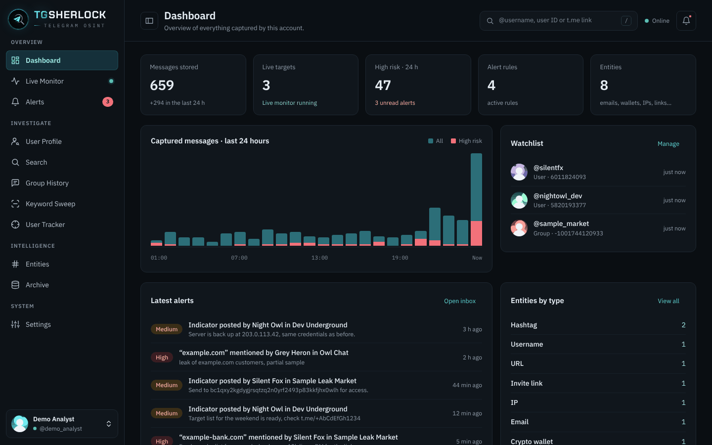
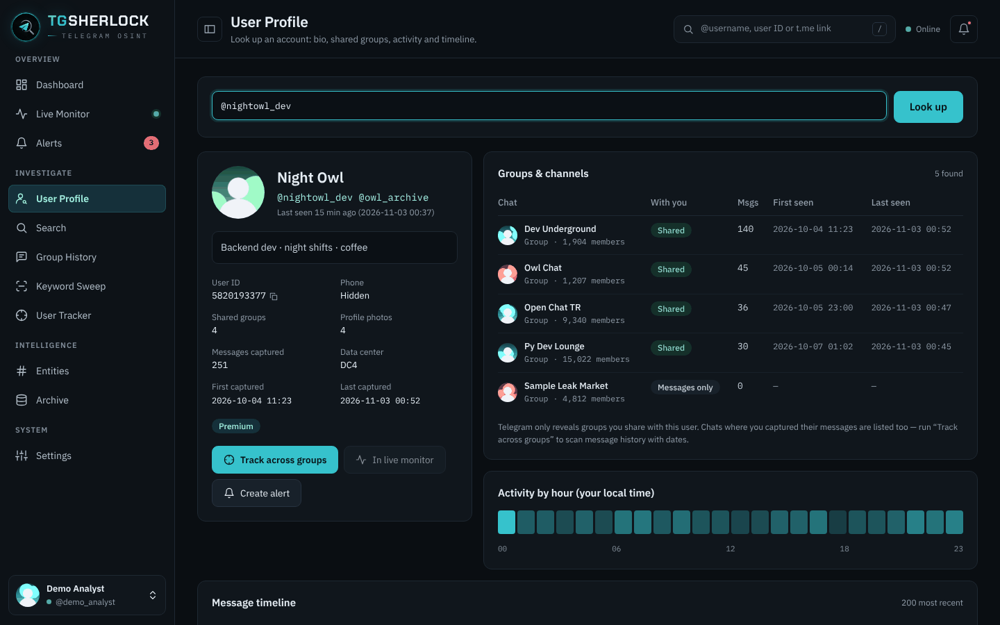

<p align="center">
  
</p>
<h1 align="center">TGSherlock</h1>
<p align="center">Telegram OSINT in a local web panel: live monitoring, alerts, user tracking and keyword sweeps.</p>




## Install

```bash
pipx install tgsherlock
```

Latest from GitHub: `pipx install git+https://github.com/emrekybs/tgsherlock.git` (if `tgsherlock` is not found afterwards, run `pipx ensurepath` and open a new terminal).

## Run

```bash
tgsherlock
```

The panel opens in your browser at `http://127.0.0.1:8765`. On Linux, the first run also adds **TGSherlock** to your application menu, so you can start it with a click.

**First run:** create an app at [my.telegram.org](https://my.telegram.org/apps) → *API development tools*, enter your **API ID** and **API Hash**, then scan the QR code with Telegram (*Settings → Devices → Link Desktop Device*). Phone-number login is available too.

## Features

- **Live Monitor**: real-time messages from chosen users, groups and channels, with optional media download.
- **Alerts**: watch a user, a group or every chat for any message, keywords, regex, media or indicators. Get notified in-app, on the desktop, by email (SMTP) or by webhook, with digest throttling.
- **User Profile**: bio, usernames, flags, shared groups, first and last seen per group, hourly activity and a dated message timeline.
- **Search**: users, groups and channels, shown with their profile photos.
- **Group History · Keyword Sweep · User Tracker**: background jobs with progress and automatic FloodWait handling.
- **Entities**: emails, phones, URLs, IPs, crypto wallets, invite links and hashtags, extracted automatically.
- **Archive & export**: filter everything you collected and export it as CSV, JSON or an HTML report.
- **Multiple accounts**: add, switch and sign out from the sidebar.

Update: `pipx upgrade tgsherlock`

Options: `--port 8790`, `--no-browser`, `--install-desktop`, `--uninstall-desktop`.
Data stays local: `~/.config/tgsherlock` (settings, sessions) and `~/.local/share/tgsherlock` (databases, media).

## Responsible use

Built for defensive OSINT and threat intelligence. TGSherlock only sees what your own Telegram account can see. Follow local law and Telegram's Terms of Service.

## License

MIT
